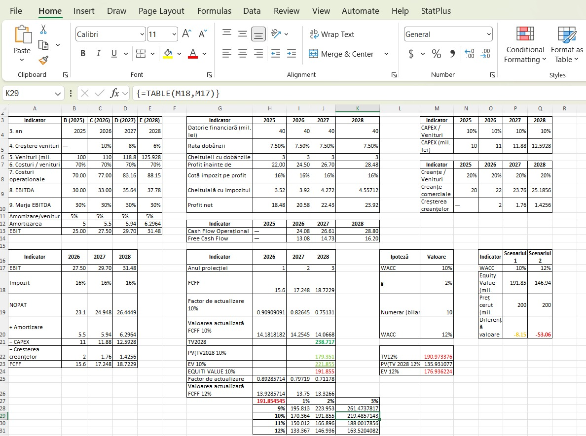
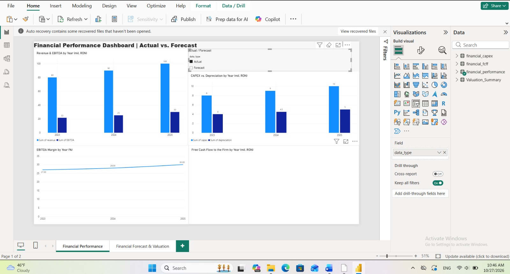
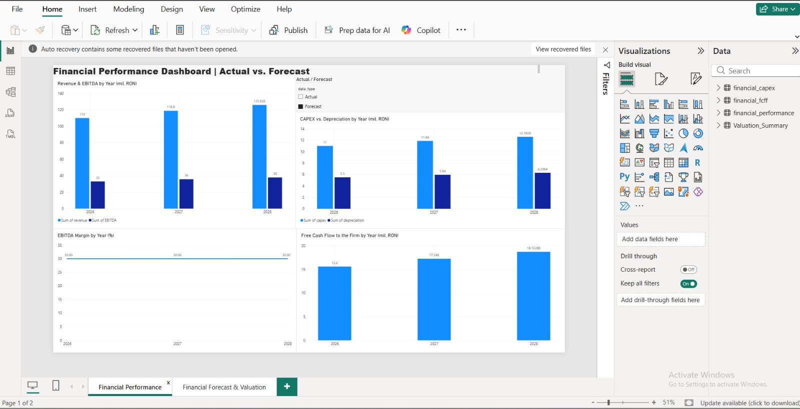
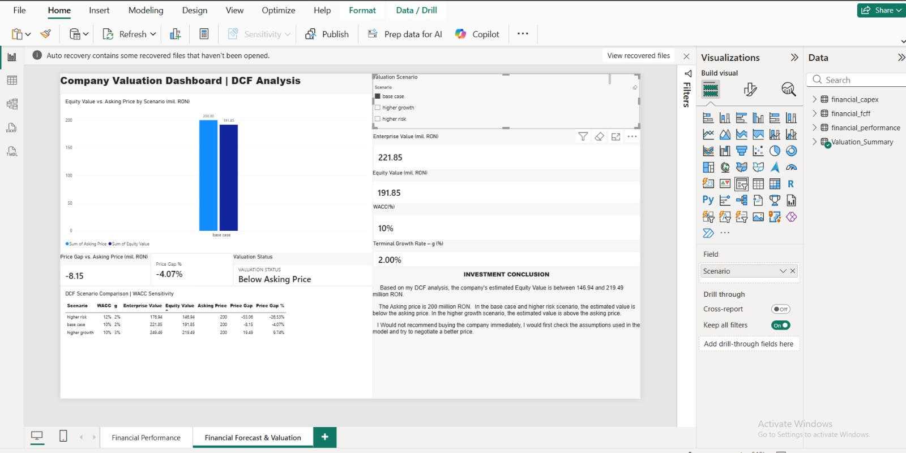
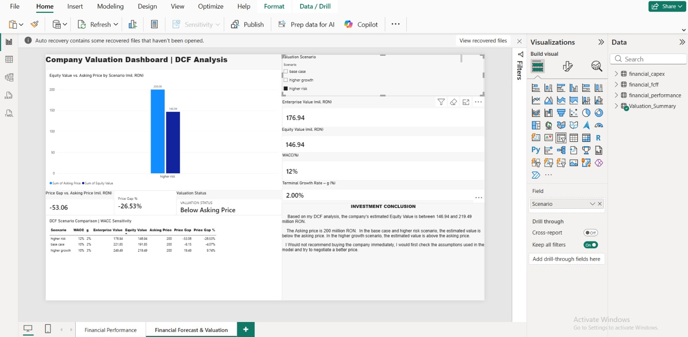
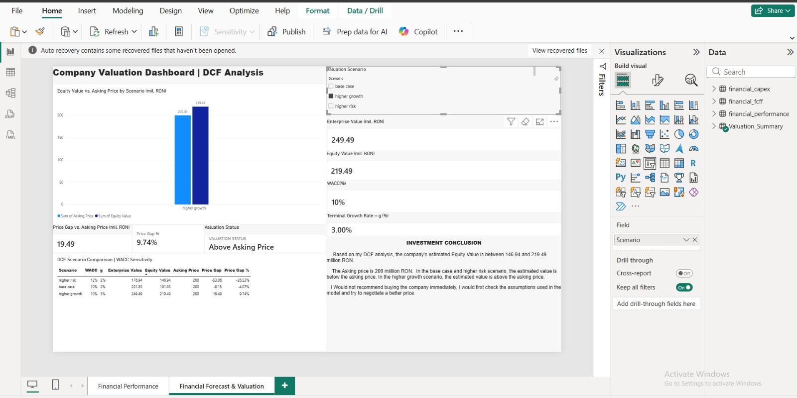

# Financial Analysis and DCF Valuation | SQL, Excel & Power BI

## Project Overview

This project is a financial analysis and company valuation exercise using SQL, Excel and Power BI.

I analyzed financial performance, created forecasts for 2026–2028 and built a Discounted Cash Flow (DCF) model to estimate the company's value.

The project uses fictional financial data and was created for learning and portfolio purposes.

## Tools Used

- **SQL (SQLite)** – Financial data analysis and calculations
- **Microsoft Excel** – Financial forecasts, DCF valuation and sensitivity analysis
- **Power BI** – Interactive dashboards and valuation scenario comparison

## Project Files

- `financial_analysis0.sql` – SQL financial analysis queries
- `financial_analysis12.db` – SQLite database
- `Financial_Model.xlsx` – Excel financial model and DCF valuation
- `Financial_Modeling_Evaluation.pbix` – Power BI dashboards

## 1. SQL Financial Analysis

I used SQL to analyze the company's financial data.

The analysis includes:

- Revenue and operating costs
- EBITDA and EBITDA margin
- Revenue and EBITDA growth
- Actual vs. Budget comparison
- CAPEX and depreciation
- Changes in receivables
- Free Cash Flow to the Firm (FCFF)

I also practiced SQL techniques such as JOIN, LAG() and Common Table Expressions (CTEs).

## 2. Excel Financial Model

In Excel, I created a financial model using actual data for 2023–2025 and forecasts for 2026–2028.

The model includes:

- Revenue and operating cost forecasts
- EBITDA, EBIT and NOPAT calculations
- CAPEX and receivables forecasts
- FCFF calculations
- DCF valuation
- WACC and terminal growth sensitivity analysis

### Main Financial Formulas

| Indicator | Formula |
|---|---|
| EBITDA | Revenue - Operating Costs |
| EBITDA Margin | EBITDA / Revenue |
| EBIT | EBITDA - Depreciation |
| NOPAT | EBIT × (1 - Tax Rate) |
| Change in Receivables | Current Receivables - Previous Receivables |
| FCFF | NOPAT + Depreciation - CAPEX - Change in Receivables |
| Enterprise Value | PV of Forecast FCFF + PV of Terminal Value |
| Equity Value | Enterprise Value - Debt + Cash |

The DCF model uses a 16% tax rate and a three-year forecast period.

For this simplified exercise, changes in receivables are used instead of a complete working capital calculation.

### Excel DCF Model

## 3. Power BI Dashboards

I created two Power BI dashboard pages.

### Dashboard 1 - Financial Performance

This page shows:

- Revenue and EBITDA by year
- EBITDA margin
- CAPEX vs. depreciation
- Forecast FCFF

The dashboard includes a slicer to switch between Actual and Forecast data.

#### Actual Data

#### Forecast Data

### Dashboard 2 - Financial Forecast & Valuation

This page presents the DCF valuation results for three scenarios:

- Base Case
- Higher Risk
- Higher Growth

It includes Enterprise Value, Equity Value, WACC, terminal growth rate, Price Gap and Valuation Status.

I used DAX measures to calculate the difference between Equity Value and the asking price.

#### Base Case

#### Higher Risk

#### Higher Growth

## 4. DCF Valuation Results

All values are in million RON.

| Scenario | WACC | Growth (g) | Enterprise Value | Equity Value | Asking Price |
|---|---|---|---|---|---|
| Base Case | 10% | 2% | 221.85 | 191.85 | 200.00 |
| Higher Risk | 12% | 2% | 176.94 | 146.94 | 200.00 |
| Higher Growth | 10% | 3% | 249.49 | 219.49 | 200.00 |

The results show how changes in WACC and terminal growth rate affect the estimated value of the company.

## 5. Investment Conclusion

Based on my DCF analysis, the company's estimated Equity Value is between 146.94 and 219.49 million RON.

The asking price is 200 million RON.

In the Base Case and Higher Risk scenario, the estimated value is below the asking price. In the Higher Growth scenario, it is above the asking price.

I would not recommend buying the company immediately. I would first check the assumptions used in the model and try to negotiate a better price.

## 6. What I Learned

Through this project, I practiced:

- Writing SQL queries for financial analysis
- Comparing actual financial results with budget values
- Building financial forecasts in Excel
- Calculating FCFF and DCF valuations
- Understanding how WACC affects company value
- Creating interactive Power BI dashboards
- Comparing different valuation scenarios
- Explaining financial results and investment conclusions

## Notes

This project uses fictional financial data and was created for educational purposes only.

The financial model includes simplified assumptions and does not represent the valuation of a real company.
